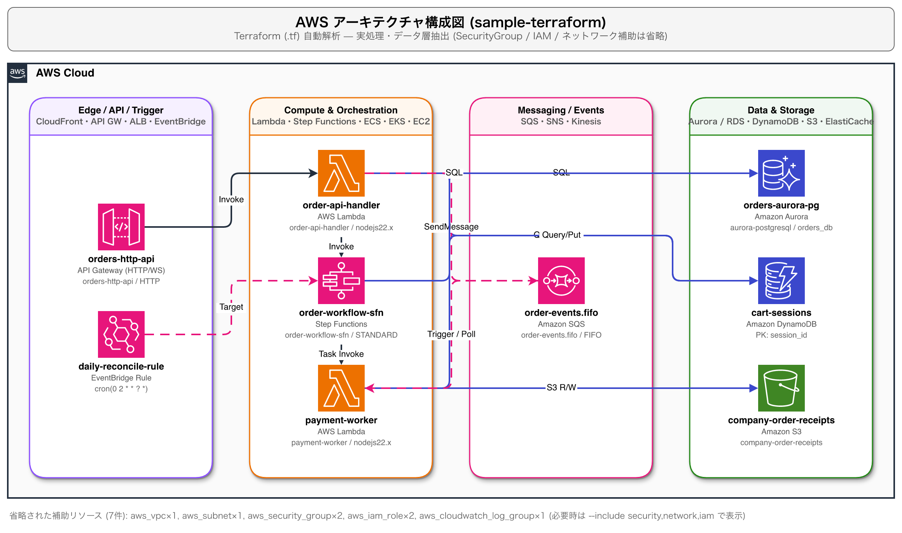
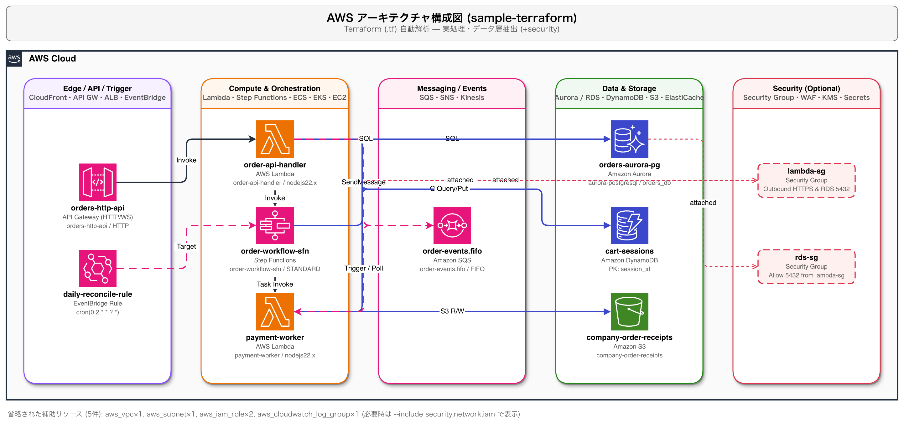

# drawio-aws-arch-skill

> **Disclaimer**: This is an independent, unofficial open-source agent skill and is **not** affiliated with, endorsed by, or sponsored by draw.io Ltd (JGraph), draw.io AG, or Amazon Web Services. `draw.io` is a registered trademark of draw.io AG.

Terraform (`.tf`) ファイル群を解析し、公式 AWS4 アイコンを用いた **AWS アーキテクチャ構成図（`.drawio` XML + XML埋め込み済み `.drawio.png`）** を自動生成する **Node.js のみ・`npm install` 不要** のエージェントスキルです。

- **実処理・データ保持層にフォーカス（デフォルト）**: `API Gateway` / `CloudFront` / `ALB` / `EventBridge` / `Lambda` / `Step Functions (SFN)` / `ECS` / `EKS` / `SQS` / `SNS` / `Aurora・RDS` / `DynamoDB` / `S3` / `ElastiCache` などを自動抽出し、接続関係（Integration / Event Source Mapping / 環境変数参照 / SFN Definition 等）も自動で矢印化します。
- **Security Group / IAM / ネットワーク補助はデフォルト省略**: 図が煩雑になりやすい `aws_security_group`、`aws_iam_role`、`aws_vpc` / `aws_subnet`、`aws_cloudwatch_log_group` 等はデフォルトで省略し、フッターに省略件数を要約表示します。必要な場合のみ `--include security,network,iam,observability` で描画できます。
- **ブラウザ不要・ゼロ依存**: 単一ファイルバンドルの変換スクリプト（`scripts/drawio2png.mjs`）を同梱しており、`npm install` なしでそのまま動作します。

---

## インストール（グローバルスキル登録）

```bash
git clone <repository-url> drawio-aws-arch-skill
mkdir -p ~/.agents/skills ~/.gemini/config/skills
ln -sfn "$(pwd)/drawio-aws-arch-skill" ~/.agents/skills/drawio-aws-arch
ln -sfn "$(pwd)/drawio-aws-arch-skill" ~/.gemini/config/skills/drawio-aws-arch
```

---

## 使い方

```bash
# デフォルト（API / Lambda / SFN / SQS / Aurora / DynamoDB / S3 のみ描画、SG等は省略）
node scripts/build-aws-arch.mjs \
  --tf-dir examples/sample-terraform \
  --output examples/output/aws-arch-default.drawio.png

# Security Group も含めて描画する場合
node scripts/build-aws-arch.mjs \
  --tf-dir examples/sample-terraform \
  --include security \
  --output examples/output/aws-arch-with-sg.drawio.png
```

---

## 生成サンプル

### デフォルト出力（Security Group / IAM / VPC は省略）


### `--include security` 指定時（Security Group を描画）


---

## ライセンス・注意事項

- 本リポジトリのコードは **[Apache License 2.0](LICENSE)** の下で提供されています（詳細は [`LICENSE`](LICENSE) および [`NOTICE`](NOTICE) を参照）。
- 同梱の `scripts/drawio2png.mjs` には draw.io OSS（Apache-2.0）および `@resvg/resvg-wasm`（MPL-2.0）が含まれます。
- draw.io 本家の `stencils/LICENSE` に基づき、同梱のアイコン・ステンシルアセットを **Atlassian 製品や Atlassian Marketplace プラグインへ組み込み・配布することは禁止**されています（出力された PNG / SVG 図面自体の利用には制限はありません）。
